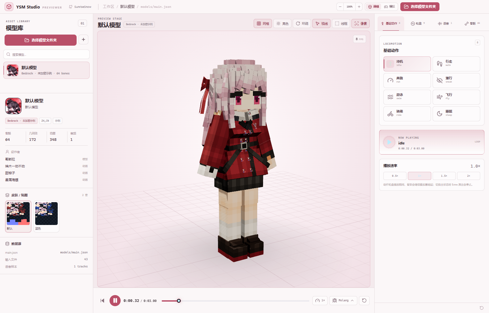

# YSM Studio Previewer

**English** · [简体中文](README.zh-CN.md)

> [!IMPORTANT]
> **AI-generated content disclaimer**
>
> A significant portion of this project, including its source code, documentation, and configuration, was generated with AI assistance. It may contain errors, omissions, insecure patterns, or inaccurate assumptions. The project is provided **"as is"**, without warranty of any kind, express or implied. Review, test, and audit it before using it in production or distributing it. The maintainers are not liable for any loss or damage arising from its use.
>
> Third-party models, textures, audio, and other assets remain the property of their respective authors and are subject to their own licenses.

Independent Windows 11 desktop previewer for **Yes Steve Model** (`.ysm`). It reads supported models in memory, then renders, animates, and auditions them without launching Minecraft.

**Preview only:** decryption and unpacking are internal in-memory steps. The app has no feature to export decrypted packages or extracted assets.

Developer and coding-agent guide: [AGENT.md](AGENT.md).



## What works

| Area | Status |
| --- | --- |
| `.ysm` V1 (AES-CBC + zlib) | ✅ verified end-to-end |
| `.ysm` V2 (AES-CBC + JavaRandom + zlib) | ✅ verified, including legacy flat layout |
| `.ysm` V3 (`YSGP`, XChaCha20/MT19937_64/CityHash64) | ✅ verified with a real V3 model |
| V3 baked geometry (`raw_meshes`) | ✅ bypasses cube reconstruction; 100% mesh fidelity |
| Bedrock cube geometry | ✅ Box UV + per-face UV + inflate + cube pivot/rotation |
| Three.js skeleton + bind pose | ✅ absolute pivots converted to local hierarchy |
| Animation blending | ✅ base locomotion + Extra overlay + idle underlay |
| Molang expressions | ✅ `molangjs`, query/ysm/v variables injected every frame |
| Sound effects on animation timeline | ✅ crossing detection, loop wrap included |
| OGG soundboard | ✅ Howler.js, seek/progress/volume/mute |
| PNG / WebP / AVIF / JPG textures | ✅ nearest/linear filter switch |
| Emissive `_e` texture pairing | ✅ attaches `emissiveMap` automatically |
| Bone tree part visibility | ✅ auto hierarchy, search, parent/child overrides |
| Wheel settings | ✅ `config_forms` checkbox / range / radio → Molang `v.*` |
| Studio / Runtime modes | ✅ runtime `pre_parallel*` layers; locked part tree |
| Card hover preview | ✅ `preview_animation` in a 15 FPS popover |
| Folder import | ✅ recursively finds `.ysm`, `ysm.json`, legacy `main.json` models |
| Large model library | ✅ search/filter and offscreen `content-visibility` |
| UI zoom | ✅ 80–140%, persisted; Ctrl +/-/0 |
| Light / dark themes | ✅ sakura light and copper dark, persisted |
| Memory-only VFS | ✅ WASM MEMFS, no plaintext extraction to disk |
| Electron desktop shell | ✅ custom `ysm://` protocol, native file/folder dialogs |
| Browser fallback | ✅ drag/drop and file/folder inputs |

## Quick start

```powershell
git clone https://github.com/FGXYX/YSM-Studio-Previewer.git
cd YSM-Studio-Previewer
npm install
npm run dev            # browser preview at http://127.0.0.1:5173
npm run electron:dev   # Windows desktop window
```

The app opens with a bundled CC0 sample model. Drop a `.ysm` anywhere into the window, or use **选择模型文件夹**. The folder picker accepts:

- a folder containing one or more `.ysm` files;
- a folder containing one or more unencrypted models (`ysm.json`);
- legacy flat models (`main.json` / `models/main.json`);
- a parent folder containing several model subfolders.

For large libraries, the sidebar has a search field; offscreen cards use `content-visibility: auto` so the DOM does not paint every model at once.

The `electron:dev` script intentionally launches Electron with:

```text
--no-sandbox --user-data-dir=.electron-profile
```

This is required on Windows sessions where the Chromium sandbox cannot initialize (`0x80000003` / exit code `2147483651`) or the default `%APPDATA%` profile is not writable (`0xC0000005`). The profile stays inside the project and is git-ignored. On a normal unrestricted desktop account you can remove both flags.

> If Windows AppData permissions block Electron, launch with an isolated profile:
> `electron . --user-data-dir=D:\path\to\profile`

If the Electron process exits immediately with `2147483651` / `0x80000003`, close stale processes and rerun the current script:

```powershell
taskkill /IM electron.exe /F
npm run electron:dev
```

## Production build

```powershell
npm run build
npm run electron:build
```

`electron:build` targets the portable executable and disables executable signing/resource editing; this avoids NSIS/7-Zip symbolic-link requirements on locked-down Windows accounts. The unpacked app under `release/win-unpacked/` is the same application and can be zipped directly.

Artifacts are written to `release/`.

- `YSM-Studio-0.1.0-win-x64.zip` — **recommended**: unzip and run `YSM Studio Previewer.exe`. No install required.
- `YSM Studio Previewer 0.1.0.exe` — single-file portable wrapper; it self-extracts into a temporary folder.
- `win-unpacked/` — unpacked application used to produce the ZIP.

The desktop shell serves `dist/` through the custom `ysm://app/` protocol so that `fetch()` and WebAssembly work under `file://`-style isolation. `asar` is intentionally disabled so the protocol handler can read files from the installed directory without an extra unpack step.

## Rebuild the WASM parser

The checked-in `public/wasm/YSMParser.js` and `YSMParser.wasm` are built from the patched `../YSMParser` sources.

```powershell
# One-time toolchain: emsdk with emcc/em++ 6.x, Python 3, and zlib/zstd sources from YSMParser/external
$env:EMSDK = 'D:\path\to\emsdk'
powershell -ExecutionPolicy Bypass -File scripts\build-wasm.ps1
```

The script compiles a C++20/WebAssembly bundle directly with `emcc`/`em++`, avoiding the CMake preset's source-tree `zconf.h` write requirement. The CMake path remains available:

```powershell
cmake --preset wasm-web-release
cmake --build --preset wasm-web-release
```

## Architecture

```
ysm-studio/
├─ electron/
│  ├─ main.cjs              # window, ysm:// protocol, native dialogs
│  └─ preload.cjs           # contextBridge API
├─ src/
│  ├─ parser/
│  │  ├─ wasmParser.ts       # MEMFS bridge + ysm_parse_bytes
│  │  ├─ projectParser.ts    # ysm.json / geometry / textures / lang / extras
│  │  └─ importers.ts        # .ysm, folder, drag/drop, demo, native dialogs
│  ├─ viewer/
│  │  ├─ YsmViewer.ts        # Three.js scene, skeleton, materials, controls
│  │  └─ animation.ts        # keyframe sampling, Molang, sound events
│  ├─ audio/AudioEngine.ts   # Howler.js effects + soundboard
│  ├─ store/studio.ts        # zustand UI state
│  ├─ components/            # Win11-style panels, wheel, timeline, Molang
│  └─ styles.css
├─ public/
│  ├─ wasm/                  # YSMParser.js + .wasm
│  └─ samples/default/       # bundled demo (CC0 model + one CC BY-NC-SA cue)
└─ scripts/                  # WASM build, sample sync, smoke tests
```

Three data paths feed the same `ParsedProject`:

1. **Encrypted `.ysm`** → `parseYsmBytes()` writes the byte stream into Emscripten MEMFS → `ysm_parse_bytes()` calls the patched V1/V2/V3 parsers → host reads `/ysm/out-*` recursively.
2. **Unencrypted folder** → browser directory input / Electron dialog / drag-drop → file map.
3. **Bundled demo** → `public/samples/default/manifest.json` → file map.

No decrypted asset ever touches the user's disk.

## Coordinate handling

YSM renders Blockbench assets in a mirrored X space. Getting this wrong makes both arms rotate inward and meet between the legs, which is especially visible on models with the common `LeftArm Z=-18° / RightArm Z=+18°` bind pose.

- **V1/V2 and unencrypted cube assets** are converted by the viewer:
  - bone/cube pivot and geometry X → negated;
  - bone/cube rotation `(x, y, z)` → `(-x, -y, z)`;
  - each face's U axis → reversed, matching OpenYSM's `u0/u1` swap.
- **V3 `raw_meshes`** are already exported in that mirrored space by `YSMParserV3.cpp`, so the viewer applies no second mirror to bind poses or geometry.
- **Animation channels are converted for every format**: rotation `(x, y, z)` → `(-x, -y, z)` and position X → negated. OpenYSM's `RotationValue.convert()` and `RenderUtils.translateMatrixToBone()` do the same. Without this, arm and leg swing phases run in opposite directions.
- Bedrock units remain Blockbench units inside a `1/16` scaled root group.
- Absolute bone pivots become local positions against the parent pivot.
- Bind rotations use **ZYX** order, matching OpenYSM's `RotateZYX` render path.
- UVs use a top-left normalized space; `1 - v` is applied with Three's default `flipY` upload.

## Part visibility

The **骨骼** tab on the right side builds a bone tree from the model's real `parent` links instead of a fixed part list. Moving it out of the narrow left library column gives the hierarchy room to display.

- Only bones with geometry or visible descendants are shown; empty locator chains are omitted.
- Search filters the tree and keeps ancestor paths.
- “展开常用” opens the paths to common parts (`Hair`, `Head`, `Face`, arms, hands, legs, skirts, capes, tails, wings, …).
- Visibility is stored as explicit overrides. The nearest override wins, so a deeply selected child can be shown even while its parent is hidden.
- Hiding a part only changes its mesh visibility; animations continue to evaluate, so re-showing it restores the current pose immediately.
- Overrides are local to the current model and reset when switching models.

## Wheel settings

YSM wheel entries whose value starts with `#` are settings pages, not animations. For example:

```json
"extra_animation": {
  "自定义模型": "#自定义模型",
  "表情设置": "#表情设置"
}
```

The app now:

- keeps those entries in the wheel as settings slots (gear icon);
- reads `extra_animation_buttons[].config_forms`;
- supports `checkbox`, `range`, and `radio`;
- localizes titles, descriptions, and radio labels from the model language files;
- applies changes to the live model through Molang variables such as `v.roaming.face` and `v.roaming.Player_zoom`.
- radio options support **hover preview**: hovering temporarily applies the option, leaving restores the previous value, and clicking commits it.

`radio` labels may contain multiple assignments (`v.roaming.pupil=1;v.roaming.fc=0;`), and all of them are applied together. Values are re-evaluated on every animation frame; they are not persisted after switching models.

The old `extra_animation_classify` submenu entries are still flattened into the extra list, while `#...` entries backed by a config group open the settings panel.

## Studio and Runtime modes

The title bar switches between two modes.

**Studio** is the authoring view:

- all parts are available in the bone tree;
- manual part visibility is editable;
- undeclared fallback clips appear under “调试动作”.

**Runtime** simulates the in-game state:

- applies the model's `pre_parallel*` / `parallel*` layers around the base action, and evaluates their Molang scale/visibility expressions;
- uses the default game state (grounded, no equipment) as Molang input;
- manual part visibility is locked and reset, so visibility follows the model's own animation/config logic;
- undeclared fallback clips are hidden from the wheel;
- a `SIMULATION` badge is shown in the stage header.

**Studio** deliberately skips those runtime layers, so both variants of a configurable part remain visible. This is what “all assets” means: the base animation still plays, but `pre_parallel*` scale expressions do not hide the unselected face/colour pieces.

Runtime does not guess which bones are “eyes” or “clothes”. Those are controlled by the model's own `v.*` configuration and `pre_parallel*` scale expressions, which avoids overriding the author's intent.

## Where the default appearance comes from

There is no separate `default.json` / `visibility.json` in a YSM package. The package contains `ysm.json`, `models/`, `animations/`, `controller/`, `textures/`, `sounds/` and `avatar/`.

The in-game default appearance is assembled from:

- `properties.default_texture` — default texture;
- `properties.preview_animation` — GUI preview clip (not the in-world idle);
- `properties.extra_animation_buttons[].config_forms` — config variable defaults;
- `animations/*.animation.json` — `idle`, `pre_parallel0..7`, `parallel0..7`;
- `controller/*.controllers.json` — controller state machines.

For example, in the tested model `pre_parallel1` has 310 bones and 309 scale channels; expressions like `v.roaming.face == 0` and `v.roaming.colour == 1` hide the unselected face/colour variants. `pre_parallel6/7` drive floating expression icons, and `parallel0` is a first-person arm layer (skipped for the third-person preview).

`v.*` values are exposed to molangjs as `variable.*` because molangjs rewrites `v.foo` to `variable.foo`.

## Card hover preview

Model cards keep their static avatar thumbnail. Hovering a card opens a single 220×260 3D popover that:

- loads that project with its `default_texture`;
- plays `properties.preview_animation` (`gui`, `Menu`, …) and falls back to `idle`;
- applies the default config values / `pre_parallel*` layers;
- hides grid, contact shadow, and real-time shadows;
- runs at 15 FPS, then suspends rendering when the pointer leaves;
- reuses one persistent WebGL context for all card previews instead of creating one context per hover.

Only one card preview is alive at a time, so a large 800-bone model does not multiply into one scene per library card.


## Retest fixtures

```powershell
# Build a valid V1 archive from the bundled demo (test only)
node scripts/make-test-ysm.mjs

# Browser smoke test (requires `npm run dev` and Chrome)
node scripts/smoke.mjs

# Encrypted V1/V2/V3 end-to-end checks
node scripts/wasm-test.mjs
$env:YSM_TEST_FILE = 'D:\path\to\sample-v2.ysm'; node scripts/v2-test.mjs
$env:YSM_TEST_FILE = 'D:\path\to\sample-v3.ysm'; node scripts/v3-test.mjs
```

Test `.ysm` files used during development are not redistributed. Point `YSM_TEST_FILE` at your own legally obtained V2/V3 model. The generated `default-v1.ysm` is derived from the CC0 default model and can be regenerated with `node scripts/make-test-ysm.mjs`.

## Known limits

- Animation controllers are not executed as a full state machine; the previewer intentionally uses the same visual layering model (base locomotion + Extra overlay + idle underlay) rather than emulating every OpenYSM controller condition.
- Physics bones are driven by their authored keyframes; a full first-order/second-order physics solver is not yet simulated.
- `hold_on_last_frame` clips keep their final pose until the user stops them.
- Extremely large archives are limited by the WASM heap (`ALLOW_MEMORY_GROWTH` is enabled; initial heap is 16 MB).
- Minecraft formatting codes (`§6`, `&a`) are stripped for display.

## License

The original source code of this repository is released under the **MIT License**. See [LICENSE](LICENSE).

Third-party components, the Electron/Chromium runtime, and bundled demo assets have separate terms. See [THIRD_PARTY_NOTICES.md](THIRD_PARTY_NOTICES.md) before redistributing a build. In particular:

- the bundled demo audio `sounds/chime.ogg` is **CC BY-NC-SA 4.0** and must be replaced for commercial distribution;
- third-party model packs used during development are not included in this repository and must not be redistributed without permission.

## Credits

- **YSMParser** / **OpenYSM** — upstream C++ parser and GeckoLib data model.
- **Three.js**, **molangjs**, **Howler.js**, **React**, **Vite**, **Tailwind CSS**, **lucide-react**.
- Bundled default model: CC0, from OpenYSM `builtin/default`.
- Bundled demo cue `sounds/chime.ogg`: CC BY-NC-SA 4.0, from OpenYSM Wine Fox `14_momo/sounds/fly_on.ogg`; used only for the local demo. Replace it for commercial distribution.
- YSM and Yes Steve Model are projects of their respective authors; this tool is an independent viewer.
